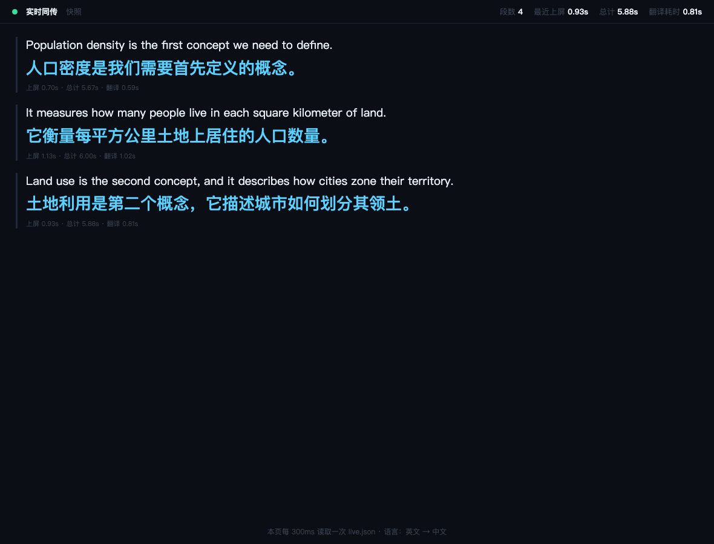

# live-caption

**Real-time bilingual (Chinese/English) live captions with on-the-fly Chinese translation — fully local, no cloud, no API keys.**

Speaks English or Chinese (or mixes both mid-sentence) → you see the transcript word-by-word and a natural Chinese translation, and every session is saved as a Word document you can read, print or hand in.

```
[042] So we looked at the Airbnb listings data, and then we found that
      因此，我们查看了 Airbnb 的房源数据，然后发现
[043] the housing price distribution in London is not normal at all.
      伦敦的房价分布根本不是正态分布。
```



---

## Why this exists

Most "real-time translation" tools either send your audio to someone else's server, or use one ASR model and accept its mistakes. Taking lecture notes in a second language needs something different:

- **Audio must stay on the machine** — lectures, supervision meetings and interviews are not content you upload.
- **Two ASR passes beat one.** A *streaming* model gives instant feedback (so you can follow along), while a stronger *offline* model re-transcribes each finished segment for the final text. This is why the preview and the saved transcript can differ slightly — on purpose.
- **Latency is a tuning problem, not a hardware problem.** On an M-series laptop the whole pipeline is fast; what dominates end-to-end delay is *how long you wait before deciding a sentence has ended*. This repo exposes that knob and documents what it costs in accuracy.

## Features

- **Two-stage ASR** — streaming zipformer for instant preview, SenseVoice for the final transcript.
- **Bilingual, code-switch friendly** — Chinese, English, and sentences that start in one and end in the other.
- **Translation with context** — each segment is translated with the previous two (EN, ZH) pairs so terminology and pronouns stay consistent.
- **Smart segmentation** — silence-based cuts when possible; a hard cap with a *smart grace window* when someone talks without pausing.
- **Word-level overlap stitching** — the tail of one segment is re-fed to the next so words cut in half (`Trans|port`, `kilo|metre`) get repaired.
- **Live terminal UI** that never scrolls, plus an optional browser subtitle page.
- **Auto-saving Word export** — every 60 s and on exit, so a closed laptop never loses a session.
- **Built-in WER harness** (`eval.mjs`) so segmentation changes are judged by numbers, not vibes.

## How it works

```
mic2pcm (Swift / AVFoundation, 16 kHz mono PCM16)
      │
      ▼
captioner.mjs
      ├── streaming zipformer ──────► live preview (grows word by word)
      ├── VAD + segmentation ───────► decides where a segment ends
      ├── SenseVoice (offline) ─────► final transcript for that segment
      ├── Ollama qwen3:8b ──────────► Chinese translation (+2 context pairs)
      └── outputs
            ├── terminal UI (never scrolls)
            ├── subtitles.html   ── optional, served on :8790
            ├── transcript.jsonl ── machine-readable log
            └── 翻译文件/*.docx   ── bilingual Word document
```

### Segmentation strategy (the interesting part)

| Mechanism | Default | What it does |
|---|---|---|
| `silenceHoldMs` | 800 | Cut when the speaker has been quiet this long. Fastest path. |
| `chunkMs` | 5000 | Hard cap: never let a segment exceed this without cutting. |
| `chunkGraceMs` | 800 | If the cap is hit *mid-sentence* (hanging conjunction, or still talking), wait up to this much longer to find a pause. Total is strictly capped at `chunkMs + chunkGraceMs`. |
| `overlapMs` | 300 | Re-feed the tail audio to the next segment, then de-duplicate the text. Repairs words cut in half. |

The hard cap is what keeps latency bounded; the grace window is what stops the cap from butchering sentences. Tuning either one trades the other off.

## Requirements

- **macOS 14+ on Apple Silicon.** The Swift microphone capture and `sherpa-onnx-darwin-arm64` are arm64-only. Intel Macs and Linux would need a different capture path and a different sherpa-onnx platform package (PRs welcome).
- **Node.js 18+**
- **Xcode Command Line Tools** (`xcode-select --install`) — to compile the 100-line Swift mic tool.
- **Ollama** — <https://ollama.com> — for translation.
- **Python 3 + `python-docx`** — optional, only for Word export.

## Quick start

```bash
git clone https://github.com/<you>/live-caption.git
cd live-caption

# 1. recognition engine (sherpa-onnx)
npm install
#    no npm? → node setup.mjs

# 2. models (~440 MB, one time)
node setup-model.mjs

# 3. microphone tool
swiftc -O -target arm64-apple-macos14.0 -module-cache-path ./mcache mic2pcm.swift -o mic2pcm

# 4. translation model
ollama pull qwen3:8b

# 5. optional: Word export
pip install python-docx

# 6. run
./start.sh
```

First run will ask for microphone permission (System Settings → Privacy & Security → Microphone).

## Usage

```bash
./start.sh                     # microphone → live captions
./start.sh --chunk-ms 6000     # more complete sentences, higher latency
./start.sh --chunk-ms 4500     # snappier, may cut sentences
./start.sh --city Beijing      # city name in the Word title
./start.sh --no-translate      # recognition only (measure ASR latency alone)
./start.sh --replay file.pcm   # replay a 16 kHz mono PCM file at real-time speed
```

Stop with **Ctrl-C**. You do not have to: the Word document is also refreshed every 60 seconds.

**Browser view** (optional, second terminal):

```bash
node serve.mjs        # then open http://127.0.0.1:8790/
```

### Command-line flags

| Flag | Default | Meaning |
|---|---|---|
| `--chunk-ms N` | 5000 | Hard segment cap. Lower = faster, more cuts. |
| `--silence-ms N` | 800 | Silence that ends a segment. |
| `--grace-ms N` | 800 | Smart grace window at the hard cap. |
| `--overlap-ms N` | 300 | Tail overlap between segments (0 = off). |
| `--model NAME` | qwen3:8b | Any Ollama chat model. |
| `--no-translate` | — | Recognition only. |
| `--city NAME` | London | Title in the exported Word file. |
| `--replay FILE` | — | Replay a PCM file instead of the mic. |
| `--verbose` | off | Diagnostics to the terminal. |

## Measured latency and accuracy

Measured on an Apple M-series laptop with a 33-second bilingual lecture clip, using `--replay` (so audio timing is exact) and `eval.mjs` for WER:

| `chunkMs` | Mean time from speech start → caption | Median | Max | WER (lecture / continuous) |
|---|---|---|---|---|
| 6500 | 6462 ms | 6810 ms | 7410 ms | 1.5% / 1.7% |
| 6000 | 6427 ms | 6658 ms | 7239 ms | 1.5% / 1.7% |
| **5000 + smart grace (default)** | **5489 ms** | 5756 ms | 6417 ms | ~3.0% / ~3.4% |
| 4500 | — | — | — | 10.4% / 0.0% |

Notes from the tuning runs:

- **6000 and 6500 produce identical WER**, so 6500 was strictly worse (same quality, +500 ms).
- Below ~5000 ms the hard cap starts landing mid-sentence. That is why `chunkGraceMs` exists: it recovers most of the sentence without letting latency run away.
- **Latency does not accumulate.** Over a 132-second run the mean was 5685 ms in the first third and 5388 ms in the last third. A steady ~5.5 s lag *feels* like it grows because the captions are always behind the video, but the queue does not build up.

Re-run the numbers yourself:

```bash
node eval.mjs transcript.jsonl truth.txt
```

## Word export

Each session writes a bilingual `.docx` into `翻译文件/`:

- Named after the **session start time**, so auto-saves overwrite the same file instead of piling up.
- Contains every segment as **original + translation**, plus session stats (segment count, duration, median latency, models used).
- Written every 60 s and on exit — closing the terminal still leaves a usable file.

If Word export fails, `transcript.jsonl` always holds the full session.

## Troubleshooting

| Symptom | Cause / fix |
|---|---|
| `找不到 node` | Install Node 18+, or the script falls back to a local runtime path. |
| `找不到 SenseVoice 模型` | `node setup-model.mjs` |
| `识别引擎未安装` | `npm install` (or `node setup.mjs --from-dsh`) |
| No subtitle appears | Check mic permission; try `./start.sh --replay test.pcm` to isolate ASR from audio input. |
| Translation is empty | `ollama serve`, then `ollama pull qwen3:8b`; the app requests `think: false` because qwen3 hides its answer in the thinking block otherwise. |
| Sentences cut mid-word | Raise `--chunk-ms 6000` or `--overlap-ms 400`. |
| Captions lag too much | Lower `--chunk-ms 4500` and `--silence-ms 700`, accept more cuts. |

## Project layout

```
captioner.mjs      main pipeline: capture → segment → ASR → translate → display/export
mic2pcm.swift      100-line AVFoundation mic capture → raw PCM on stdout
serve.mjs          tiny HTTP server for the browser subtitle page
subtitles.html     the browser view
setup.mjs          install & self-check the sherpa-onnx engine
setup-model.mjs    download the two ASR models
make_docx.py       render a session payload into a bilingual Word document
eval.mjs           WER evaluation against a ground-truth transcript
start.sh           dependency checks + launch
```

## Limitations

- **macOS arm64 only** for now.
- **Chinese/English focused.** SenseVoice also understands Japanese, Korean and Cantonese, but segmentation, prompts and evaluation are tuned for zh/en.
- **Translation quality is an 8B local model's.** Accurate but sometimes literal; swap `--model` if you have something better.
- **~5.5 s lag on continuous speech** is the price of waiting for sentence boundaries. Lower `--chunk-ms` to trade accuracy for speed.
- **Silence and music can hallucinate.** Whisper-family models sometimes invent text; the app filters very short segments but cannot eliminate it.

## Acknowledgements

- [sherpa-onnx](https://github.com/k2-fsa/sherpa-onnx) (k2-fsa) — the on-device ASR runtime.
- [SenseVoice](https://github.com/FunAudioLLM/SenseVoice) (FunAudioLLM) — the offline recognizer.
- [csukuangfj](https://huggingface.co/csukuangfj) — the converted streaming zipformer and SenseVoice ONNX models.
- [Ollama](https://ollama.com) and [Qwen](https://github.com/QwenLM/Qwen3) — local translation.

## License

MIT — see [LICENSE](LICENSE).

---

## 中文说明

**这是什么**：本地运行的中英双语实时字幕 + 中文翻译工具。说中文或英文（可以一句话里混着说），终端实时显示原文与译文，并按会话自动生成双语 Word 文档。音频全程不出本机。

**核心设计**：
- **双识别引擎**：流式 zipformer 负责"边说边出字"的即时预览，SenseVoice 负责每段结束后的高准确率定稿。
- **分句策略**：优先靠静音切分；说话人不停顿时用硬上限兜底，并允许"句子没说完就多等一会儿"的智能宽限。
- **切点重叠**：把上一段尾部音频带到下一段重新识别，修复被切断的词（如 `Trans|port`）。

**快速开始**：

```bash
npm install            # 识别引擎
node setup-model.mjs   # 两个模型，约 440MB
swiftc -O -target arm64-apple-macos14.0 -module-cache-path ./mcache mic2pcm.swift -o mic2pcm
ollama pull qwen3:8b   # 翻译模型
./start.sh             # 启动
```

停止按 `Ctrl-C`；不按也不会丢内容，每 60 秒会覆盖保存一次 Word。

**实测延迟**：连续讲话时平均约 5.5 秒（原 6.5 秒配置约 6.5 秒），且**不会随时间累积**。想更快用 `--chunk-ms 4500`，想句子更完整用 `--chunk-ms 6000`。
